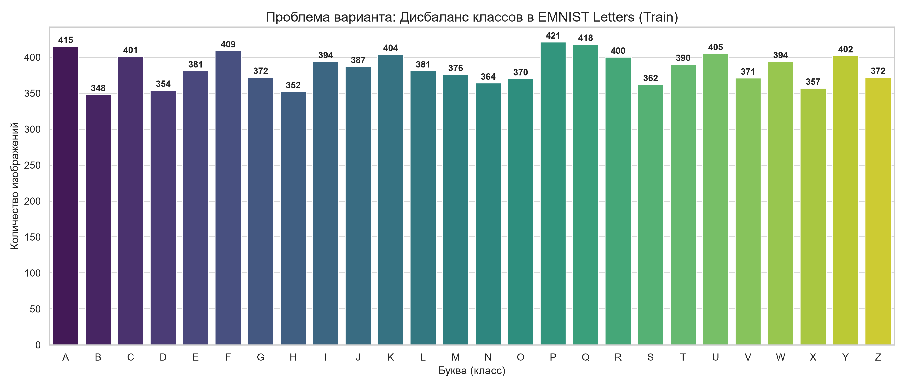
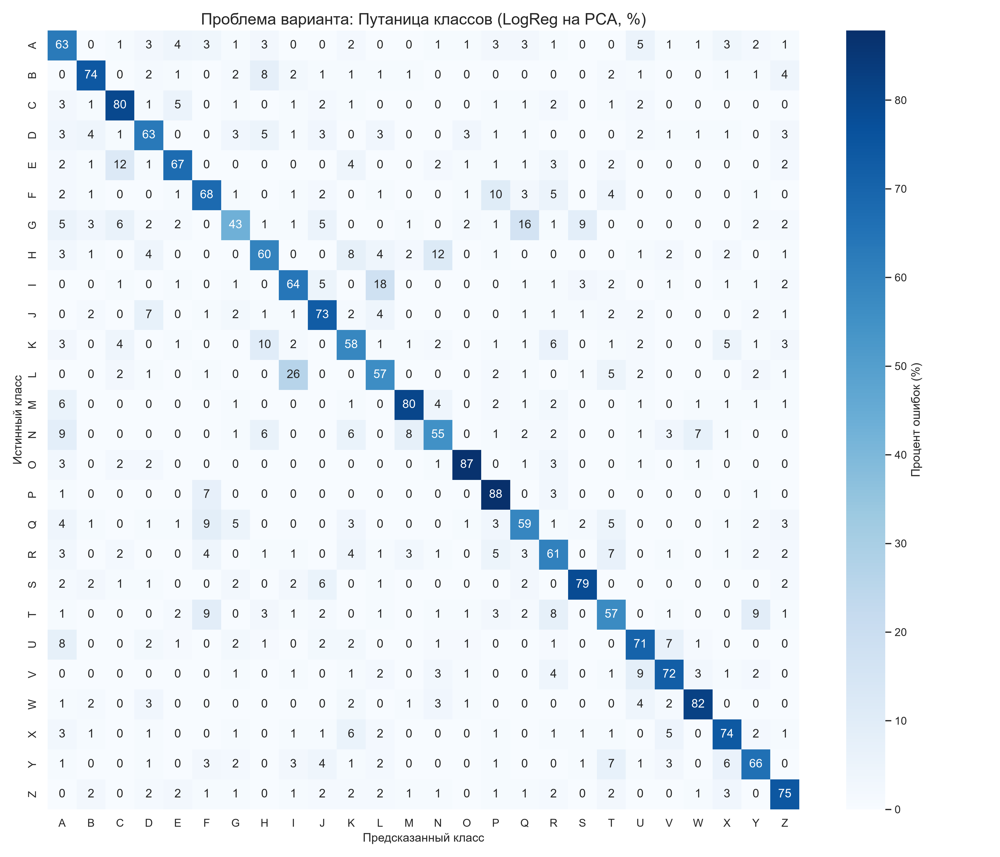

# Лабораторная работа 1. Вариант 38: EMNIST Letters

## 1. Паспорт данных
*   **Источник:** EMNIST (Extended MNIST), split `letters`.
*   **Лицензия:** Для исследовательских и учебных целей.
*   **Хеш-суммы:** Зафиксированы в `hash_manifest.json` (SHA-256).
*   **Объём:** Полный датасет — 145 600 изображений (124 800 train / 20 800 test).
*   **Поля:** Изображение (28x28, grayscale), метка класса (1-26).
*   **План разбиения:** Стандартное разбиение torchvision (train/test).

## 2. Результаты EDA
Машиночитаемые сводки сохранены в `report_summary.csv`.

### 2.1 Проблема дисбаланса классов
На графике ниже видно распределение классов в тренировочной выборке. Данные имеют незначительный дисбаланс.

### 2.2 Проблема путаницы классов
Модель LogReg на PCA(64) была обучена для выявления схожести букв. Матрица ошибок показывает, с каким процентом модель путает классы (например, I и L).

*   **Пропуски:** 0 (все картинки имеют метки).
*   **Дрейф:** Не выявлен (датасет статичен).

## 3. Нумерованные выводы (каждый с числом)
1. Общее количество проанализированных изображений в тренировочной выборке: **10000**.
2. Количество классов (букв) в датасете: **26**.
3. Минимальное количество изображений в одном классе: **349**.
4. Максимальное количество изображений в одном классе: **408**.
5. Класс с наименьшим числом примеров: **B**.
6. Класс с наибольшим числом примеров: **J**.
7. Доля пропущенных значений: **0**%.
8. Точность модели LogReg на PCA(64) на тестовой выборке: **72.0**%.
